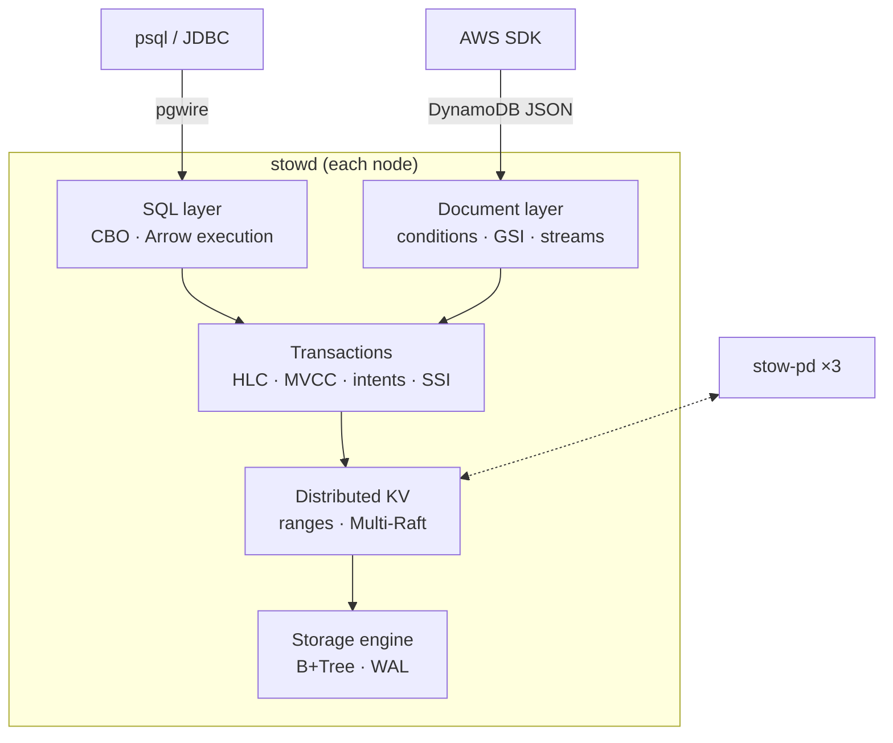

**English** | [中文](README.zh.md)

# Stowage

**A distributed SQL + NoSQL database written in Rust: a Raft-replicated,
serializable key space with a Postgres-protocol SQL layer and a DynamoDB-compatible
document API.**

*Stowing* is the warehouse step where every item gets a place on a shelf. Stowage
gives every row and every item a place in one ordered, replicated key space. Both
front ends then read and write that key space through the same transactions.

| Requirement (from database-internals roles at large tech companies) | Where Stowage covers it |
|---|---|
| Storage engines (B-Tree / LSM), buffer management | hand-written B+Tree + buffer pool, with an LSM adapter for comparison |
| WAL, crash recovery | CRC-framed WAL, redo + checkpoints, crash-loop tests under torn writes |
| Concurrency control, MVCC, isolation levels | HLC-timestamped MVCC, Snapshot Isolation and Serializable (SSI) |
| Consensus and sharding | hand-written Multi-Raft, range split/merge, placement driver |
| Distributed transactions | write intents + transaction records + 2PC across ranges |
| Query processing and optimization | sqlparser → binder → Cascades-style cost-based optimizer → vectorized Arrow execution |
| Operability | online schema change, CDC, backup / PITR, per-tenant quotas, TLS, RBAC, audit, metrics, tracing |
| Correctness at scale | deterministic simulation, linearizability and Elle-style checkers, fuzzing, `loom` |

## Architecture



Stowage is deliberately **CP**: a write is acknowledged only once a Raft majority has
it. Its companion project [Cartwheel](https://github.com/FufanLu/Cartwheel) is a
leaderless, always-writable Dynamo-style (AP) store. Milestone M9 benchmarks the two
side by side. See [ADR 0003](docs/adr/0003-layered-cp-architecture.md).

## Status

| Milestone | Scope | State |
|---|---|---|
| M0 | workspace, CI, environment traits, HLC, deterministic simulator | ✅ |
| M1 | B+Tree, buffer pool, WAL, recovery | ⏳ |
| M2 | Raft (pre-vote, leases, snapshots, membership change) | |
| M3 | Multi-Raft, range split/merge, placement driver | |
| M4 | distributed transactions, SI / SSI | |
| M5 | SQL engine + Postgres wire protocol | |
| M6 | DynamoDB API, CDC, online schema change | |
| M7 | security, backup / PITR, quotas, observability | |
| M8 | ops console, Helm | |
| M9 | benchmarks, chaos, compatibility runs | |

## Quick start

```bash
make check                                   # fmt + clippy + tests + cargo-deny
make sim N=500                               # 500 fresh random simulation seeds
STOWAGE_SIM_SEED=42 cargo nextest run -p stowage-sim   # replay one seed
make trace SEED=42                           # print a real simulation trace
cargo run -p stowd -- --data-dir /tmp/stowage/n1
```

Requires the Rust toolchain pinned in `rust-toolchain.toml` (rustup installs it
automatically), plus `cargo-nextest` and `cargo-deny`.

## Documentation

- [Architecture](docs/ARCHITECTURE.md)
- [Illustrated chapters](docs/illustrated/README.md): one request at a time, real data only
- [Architecture decision records](docs/adr/README.md)
