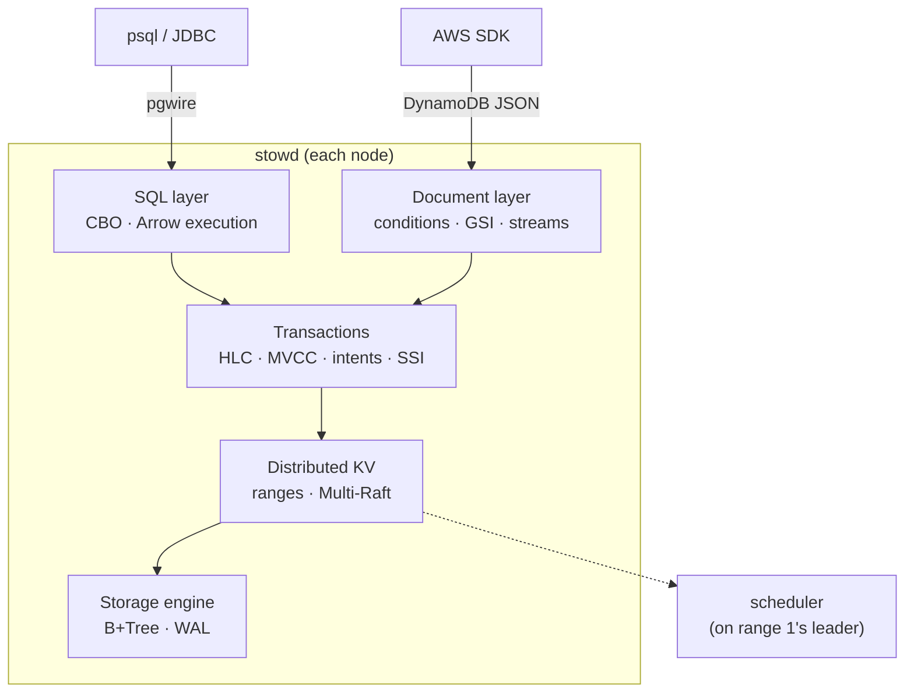

**English** | [中文](README.zh.md)

# Stowage

**A distributed SQL + NoSQL database written in Rust: a Raft-replicated,
serializable key space with a Postgres-protocol SQL layer and a DynamoDB-compatible
document API.**

*Stowing* is the warehouse step where every item gets a place on a shelf. Stowage
gives every row and every item a place in one ordered, replicated key space. Both
front ends then read and write that key space through the same transactions.

| Requirement (from database-internals roles at large tech companies) | Where Stowage covers it |
|---|---|
| Storage engines (B-Tree / LSM), buffer management | hand-written B+Tree + buffer pool, with an LSM adapter for comparison |
| WAL, crash recovery | CRC-framed WAL, redo + checkpoints, crash-loop tests under torn writes |
| Concurrency control, MVCC, isolation levels | HLC-timestamped MVCC, Snapshot Isolation and Serializable (SSI) |
| Consensus and sharding | hand-written Multi-Raft, range split/merge, placement driver |
| Distributed transactions | write intents + transaction records + 2PC across ranges |
| Query processing and optimization | sqlparser → binder → Cascades-style cost-based optimizer → vectorized Arrow execution |
| Operability | online schema change, CDC, backup / PITR, per-tenant quotas, TLS, RBAC, audit, metrics, tracing |
| Correctness at scale | deterministic simulation, linearizability and Elle-style checkers, fuzzing, `loom` |

## Architecture



Stowage is deliberately **CP**: a write is acknowledged only once a Raft majority has
it. Its companion project [Cartwheel](https://github.com/FufanLu/Cartwheel) is a
leaderless, always-writable Dynamo-style (AP) store. Milestone M9 benchmarks the two
side by side. See [ADR 0003](docs/adr/0003-layered-cp-architecture.md).

## Status

| Milestone | Scope | State |
|---|---|---|
| M0 | workspace, CI, environment traits, HLC, deterministic simulator | ✅ |
| M1 | B+Tree, buffer pool, WAL, recovery | ✅ |
| M2 | Raft (pre-vote, leases, snapshots, membership change) | ✅ |
| M3 | Multi-Raft: ranges, splits, rebalancing, shared Raft log, TCP cluster + Docker compose | ✅ |
| M4 | distributed transactions, SI / SSI | ✅ |
| M5 | SQL engine + Postgres wire protocol | ✅ |
| M6 | DynamoDB API, CDC, online schema change | |
| M7 | security, backup / PITR, quotas, observability | |
| M8 | ops console, Helm | |
| M9 | benchmarks, chaos, compatibility runs | |

### Storage engine at a glance (M1)

500 000 random keys, single thread, M3 Pro ([full results](docs/benchmarks.md),
[how to read them](docs/illustrated/02-crash-and-recover.md#25-what-durability-costs)):

| | Stowage B+Tree | LSM baseline (fjall) |
|---|---:|---:|
| point get (32 MiB cache) | **189 k ops/s** | 139 k ops/s |
| 100-key range scan | **58 k ops/s** | 14 k ops/s |
| random insert | 76 k ops/s | **239 k ops/s** |
| space / user data | **1.40×** | 2.16× |

Crash safety: 2 700 simulated power cuts with torn writes and 200 real `kill -9`s,
with 0 lost acknowledged writes and 0 half-applied batches.

### Consensus at a glance (M2)

A hand-written Raft, checked by a linearizability checker under partitions,
crashes, message loss and leader churn, plus scripted scenarios such as the paper's
Figure 8. Six classic Raft bugs were planted on purpose; the suite catches
**6 / 6** ([chapter 03](docs/illustrated/03-one-write-through-raft.md#36-do-the-tests-actually-catch-raft-bugs)).

### A cluster at a glance (M3)

```bash
docker compose -f deploy/compose/docker-compose.yml up -d --build
cargo run --release -p stowctl -- put hello world
cargo run --release -p stowctl -- ranges
```

Ranges split automatically and move between nodes. The scheduler is not a
separate service: it runs on whichever node leads range 1. On Linux in Docker
Desktop, three nodes on one laptop do 1.7–2.5 k ops/s (50 % writes, 64 clients),
and up to 4.9 k ops/s with 256 clients
([chapter 04](docs/illustrated/04-a-range-splits.md),
[benchmarks](docs/benchmarks.md#m3--three-node-cluster)).

### Transactions at a glance (M4)

Multi-range transactions in CockroachDB's style: HLC timestamps, MVCC write
intents, a transaction record whose flip to `Committed` is the commit point, and
SI or SSI per transaction. In simulation, an Elle-style checker finds no
dependency cycle under SSI and only write skew under SI. On a real three-node
cluster, `stow-bench bank` (transfers and audits, with a replay check of every
committed transfer) conserves money through a `kill -9`. Nine bugs were found on
the way, one of which only the real cluster showed
([chapter 05](docs/illustrated/05-a-transfer-transaction.md),
[ADR 0007](docs/adr/0007-transactions.md)).

### SQL at a glance (M5)

```bash
./target/release/stowd --node-id 1 … --pg-listen 127.0.0.1:5481     # every node is a SQL gateway
psql -h 127.0.0.1 -p 5481 -c "CREATE TABLE t (id INT PRIMARY KEY, v TEXT)" -c "INSERT INTO t VALUES (1, 'a')"
psql -h 127.0.0.1 -p 5482 -c "EXPLAIN ANALYZE SELECT * FROM t WHERE id = 1"   # from another node
```

A Postgres-dialect SQL engine on the transactional key space:
- a hand-written wire protocol that `psql`, pgjdbc and tokio-postgres connect to;
- a binder;
- an optimizer that orders joins by dynamic programming on `ANALYZE`
  statistics and picks primary-key or index ranges;
- an Arrow-vectorized executor.

On a real three-node cluster, a four-table join with grouping runs in about
3 ms from any node
([chapter 00](docs/illustrated/00-life-of-a-query.md),
[06](docs/illustrated/06-planning-a-query.md),
[07](docs/illustrated/07-pgwire-on-the-wire.md),
[compatibility](docs/compat.md)).

## Quick start

```bash
make check                                   # fmt + clippy + tests + cargo-deny
make sim N=500                               # 500 fresh random simulation seeds
STOWAGE_SIM_SEED=42 cargo nextest run -p stowage-sim   # replay one seed
make trace SEED=42                           # print a real simulation trace
cargo run --release -p stowage-storage --example crashtest -- loop --iterations 200
cargo run --release -p stow-bench -- engine --keys 500000
cargo run -p stowd -- --data-dir /tmp/stowage/n1
```

Requires the Rust toolchain pinned in `rust-toolchain.toml` (rustup installs it
automatically), plus `cargo-nextest` and `cargo-deny`.

## Documentation

- [Architecture](docs/ARCHITECTURE.md)
- [Illustrated chapters](docs/illustrated/README.md): one request at a time, real data only
- [Architecture decision records](docs/adr/README.md)
- [Benchmarks](docs/benchmarks.md)
