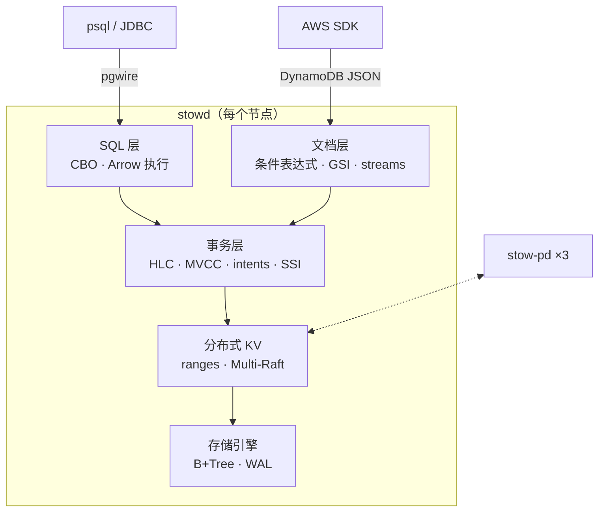

[English](README.md) | **中文**

# Stowage

**用 Rust 写的分布式 SQL + NoSQL 数据库。底层是一个 Raft 复制、可串行化的有序键空间，上面有两个前端：兼容 Postgres 协议的 SQL 层，和兼容 DynamoDB API 的文档接口。**

*Stow*（上架）是仓库里给每件货分配货架位的环节。Stowage 也是这样：每一行数据、每一个 item 都在同一个有序、多副本的键空间里有固定位置。两个前端用同一套事务读写这个键空间。

| 大厂数据库内核岗的要求 | Stowage 里对应的实现 |
|---|---|
| 存储引擎（B-Tree / LSM）、缓冲区管理 | 手写 B+Tree 和 buffer pool，另配 LSM 适配器做对照 |
| WAL、崩溃恢复 | 每条记录带 CRC 的 WAL、redo + checkpoint、在撕裂写下跑崩溃循环测试 |
| 并发控制、MVCC、隔离级别 | 用 HLC 时间戳的 MVCC，支持快照隔离（SI）和可串行化（SSI） |
| 共识与分片 | 手写 Multi-Raft、range 分裂/合并、调度器（placement driver） |
| 分布式事务 | write intent + 事务记录 + 跨 range 的 2PC |
| 查询处理与优化 | sqlparser → binder → Cascades 风格的代价优化器 → Arrow 向量化执行 |
| 可运维性 | 在线 schema 变更、CDC、备份/PITR、租户配额、TLS、RBAC、审计、指标、链路追踪 |
| 大规模下的正确性 | 确定性仿真、线性一致性检查和 Elle 风格的事务异常检查、fuzz、`loom` |

## 架构



Stowage 有意选择 **CP**：写入必须被 Raft 多数派持久化后才返回成功。配套项目 [Cartwheel](https://github.com/FufanLu/Cartwheel) 是无主、永远可写的 Dynamo 风格（AP）存储。M9 会用 YCSB 把两者放在一起跑分对比。理由见 [ADR 0003](docs/adr/0003-layered-cp-architecture.md)。

## 进度

| 里程碑 | 内容 | 状态 |
|---|---|---|
| M0 | workspace、CI、环境 trait、HLC、确定性仿真器 | ✅ |
| M1 | B+Tree、buffer pool、WAL、恢复 | ✅ |
| M2 | Raft（pre-vote、lease、snapshot、成员变更） | ⏳ |
| M3 | Multi-Raft、range 分裂/合并、调度器 | |
| M4 | 分布式事务、SI / SSI | |
| M5 | SQL 引擎 + Postgres 协议 | |
| M6 | DynamoDB API、CDC、在线 schema 变更 | |
| M7 | 安全、备份/PITR、配额、可观测性 | |
| M8 | 运维控制台、Helm | |
| M9 | 压测、混沌测试、兼容性验证 | |

### 存储引擎一览（M1）

50 万个随机 key，单线程，M3 Pro（[完整结果](docs/benchmarks.md)，[怎么解读](docs/illustrated/02-crash-and-recover.md#25-what-durability-costs)）：

| | Stowage B+Tree | LSM 对照（fjall） |
|---|---:|---:|
| 点查（32 MiB 缓存） | **189 k ops/s** | 139 k ops/s |
| 100 条范围扫描 | **58 k ops/s** | 14 k ops/s |
| 随机写入 | 76 k ops/s | **239 k ops/s** |
| 空间占用 / 用户数据 | **1.40×** | 2.16× |

崩溃安全：2700 次带撕裂写的模拟断电、200 次真实 `kill -9`，已确认的写入 0 丢失，batch 0 次只应用一半。

## 快速开始

```bash
make check                                   # fmt + clippy + 测试 + cargo-deny
make sim N=500                               # 额外跑 500 个随机仿真种子
STOWAGE_SIM_SEED=42 cargo nextest run -p stowage-sim   # 重放某个种子
make trace SEED=42                           # 打印一段真实的仿真 trace
cargo run --release -p stowage-storage --example crashtest -- loop --iterations 200
cargo run --release -p stow-bench -- engine --keys 500000
cargo run -p stowd -- --data-dir /tmp/stowage/n1
```

工具链版本固定在 `rust-toolchain.toml` 里（rustup 会自动安装），另外需要 `cargo-nextest` 和 `cargo-deny`。

## 文档

- [架构](docs/ARCHITECTURE.md)
- [图解章节](docs/illustrated/README.md)：每章跟踪一个请求，数据全部来自真实运行
- [架构决策记录（ADR）](docs/adr/README.md)
- [基准测试](docs/benchmarks.md)
