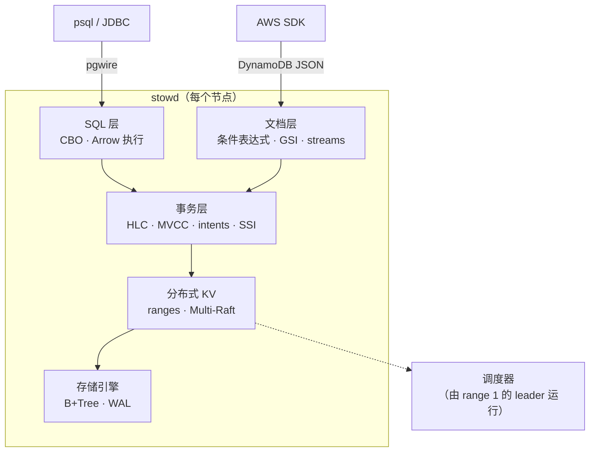

[English](README.md) | **中文**

# Stowage

**用 Rust 写的分布式 SQL + NoSQL 数据库。底层是一个 Raft 复制、可串行化的有序键空间，上面有两个前端：兼容 Postgres 协议的 SQL 层，和兼容 DynamoDB API 的文档接口。**

*Stow*（上架）是仓库里给每件货分配货架位的环节。Stowage 也是这样：每一行数据、每一个 item 都在同一个有序、多副本的键空间里有固定位置。两个前端用同一套事务读写这个键空间。

| 大厂数据库内核岗的要求 | Stowage 里对应的实现 |
|---|---|
| 存储引擎（B-Tree / LSM）、缓冲区管理 | 手写 B+Tree 和 buffer pool，另配 LSM 适配器做对照 |
| WAL、崩溃恢复 | 每条记录带 CRC 的 WAL、redo + checkpoint、在撕裂写下跑崩溃循环测试 |
| 并发控制、MVCC、隔离级别 | 用 HLC 时间戳的 MVCC，支持快照隔离（SI）和可串行化（SSI） |
| 共识与分片 | 手写 Multi-Raft、range 分裂/合并、调度器（placement driver） |
| 分布式事务 | write intent + 事务记录 + 跨 range 的 2PC |
| 查询处理与优化 | sqlparser → binder → Cascades 风格的代价优化器 → Arrow 向量化执行 |
| 可运维性 | 在线 schema 变更、CDC、备份/PITR、租户配额、TLS、RBAC、审计、指标、链路追踪 |
| 大规模下的正确性 | 确定性仿真、线性一致性检查和 Elle 风格的事务异常检查、fuzz、`loom` |

## 架构



Stowage 有意选择 **CP**：写入必须被 Raft 多数派持久化后才返回成功。配套项目 [Cartwheel](https://github.com/FufanLu/Cartwheel) 是无主、永远可写的 Dynamo 风格（AP）存储。M9 会用 YCSB 把两者放在一起跑分对比。理由见 [ADR 0003](docs/adr/0003-layered-cp-architecture.md)。

## 进度

| 里程碑 | 内容 | 状态 |
|---|---|---|
| M0 | workspace、CI、环境 trait、HLC、确定性仿真器 | ✅ |
| M1 | B+Tree、buffer pool、WAL、恢复 | ✅ |
| M2 | Raft（pre-vote、lease、snapshot、成员变更） | ✅ |
| M3 | Multi-Raft：range、分裂、再均衡、共享 Raft 日志、TCP 集群 + Docker compose | ✅ |
| M4 | 分布式事务、SI / SSI | ✅ |
| M5 | SQL 引擎 + Postgres 协议 | ✅ |
| M6 | DynamoDB API、CDC、在线 schema 变更 | ✅ |
| M7 | 安全、备份/PITR、配额、可观测性 | |
| M8 | 运维控制台、Helm | |
| M9 | 压测、混沌测试、兼容性验证 | |

### 存储引擎一览（M1）

50 万个随机 key，单线程，M3 Pro（[完整结果](docs/benchmarks.md)，[怎么解读](docs/illustrated/02-crash-and-recover.md#25-what-durability-costs)）：

| | Stowage B+Tree | LSM 对照（fjall） |
|---|---:|---:|
| 点查（32 MiB 缓存） | **189 k ops/s** | 139 k ops/s |
| 100 条范围扫描 | **58 k ops/s** | 14 k ops/s |
| 随机写入 | 76 k ops/s | **239 k ops/s** |
| 空间占用 / 用户数据 | **1.40×** | 2.16× |

崩溃安全：2700 次带撕裂写的模拟断电、200 次真实 `kill -9`，已确认的写入 0 丢失，batch 0 次只应用一半。

### 共识层一览（M2）

手写 Raft。用线性一致性检查器在网络分区、宕机、丢包和频繁换主下验证，另有手写场景测试（包括论文的 Figure 8）。我们故意植入了 6 个经典 Raft bug，测试套件全部抓到：**6 / 6**（[图解 03](docs/illustrated/03-one-write-through-raft.md#36-do-the-tests-actually-catch-raft-bugs)）。

### 集群一览（M3）

```bash
docker compose -f deploy/compose/docker-compose.yml up -d --build
cargo run --release -p stowctl -- put hello world
cargo run --release -p stowctl -- ranges
```

range 会自动分裂，并在节点之间迁移。调度器不是独立服务，由 range 1 的 leader 兼任。在同一台笔记本上用 Docker Desktop 跑 Linux 三节点：50% 写、64 个客户端时为 1.7–2.5k ops/s；256 个客户端时最高 4.9k ops/s（[图解 04](docs/illustrated/04-a-range-splits.md)，[基准](docs/benchmarks.md#m3--three-node-cluster)）。

### 事务一览（M4）

跨 range 事务，采用 CockroachDB 的做法：HLC 时间戳、MVCC write intent，以及一条事务记录（记录翻成 `Committed` 那一刻就是提交点）。隔离级别按事务选 SI 或 SSI。仿真中用 Elle 风格的检查器验证：SSI 下没有任何依赖环，SI 下只出现 write skew。在真实三节点集群上，`stow-bench bank` 跑转账加审计，并回放每一笔已提交的转账来校验；中途 `kill -9` 一个节点，钱依然守恒。开发过程中抓到 9 个 bug，其中一个只有真实集群才暴露出来（[图解 05](docs/illustrated/05-a-transfer-transaction.md)，[ADR 0007](docs/adr/0007-transactions.md)）。

### SQL 一览（M5）

```bash
./target/release/stowd --node-id 1 … --pg-listen 127.0.0.1:5481     # 每个节点都是 SQL 网关
psql -h 127.0.0.1 -p 5481 -c "CREATE TABLE t (id INT PRIMARY KEY, v TEXT)" -c "INSERT INTO t VALUES (1, 'a')"
psql -h 127.0.0.1 -p 5482 -c "EXPLAIN ANALYZE SELECT * FROM t WHERE id = 1"   # 从另一个节点查
```

这是建在事务型键空间之上的 Postgres 方言 SQL 引擎，包括：
- 手写的线协议，`psql`、pgjdbc、tokio-postgres 都能直接连；
- binder；
- 优化器：基于 `ANALYZE` 统计信息用动态规划决定 join 顺序，并选择主键或索引的扫描范围；
- 基于 Arrow 的向量化执行器。

在真实三节点集群上，从任意节点执行一条带分组的四表 join，约 3 ms（[图解 00](docs/illustrated/00-life-of-a-query.md)、[06](docs/illustrated/06-planning-a-query.md)、[07](docs/illustrated/07-pgwire-on-the-wire.md)、[兼容性](docs/compat.md)）。

### NoSQL 与 CDC 一览（M6）

```bash
./target/release/stowctl changefeed --from-start      # 每一次提交，恰好一次，按时间戳顺序
```

同一个事务型键空间同时支持 DynamoDB 的 JSON 协议：
- 条件写入、更新表达式、Query/Scan、事务和 Streams 都已实现，并用 boto3 实测；
- GSI 由 changefeed 异步维护，changefeed 保证每个已提交的版本恰好投递一次；
- `CREATE INDEX` 在线构建，期间写入不受阻塞。

详见[图解 08](docs/illustrated/08-a-dynamodb-putitem.md)、[图解 09](docs/illustrated/09-online-add-index.md)、[兼容性](docs/compat.md#dynamodb-compatibility)。

## 快速开始

```bash
make check                                   # fmt + clippy + 测试 + cargo-deny
make sim N=500                               # 额外跑 500 个随机仿真种子
STOWAGE_SIM_SEED=42 cargo nextest run -p stowage-sim   # 重放某个种子
make trace SEED=42                           # 打印一段真实的仿真 trace
cargo run --release -p stowage-storage --example crashtest -- loop --iterations 200
cargo run --release -p stow-bench -- engine --keys 500000
cargo run -p stowd -- --data-dir /tmp/stowage/n1
```

工具链版本固定在 `rust-toolchain.toml` 里（rustup 会自动安装），另外需要 `cargo-nextest` 和 `cargo-deny`。

## 文档

- [架构](docs/ARCHITECTURE.md)
- [图解章节](docs/illustrated/README.md)：每章跟踪一个请求，数据全部来自真实运行
- [架构决策记录（ADR）](docs/adr/README.md)
- [基准测试](docs/benchmarks.md)
