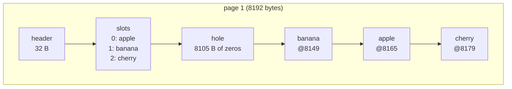
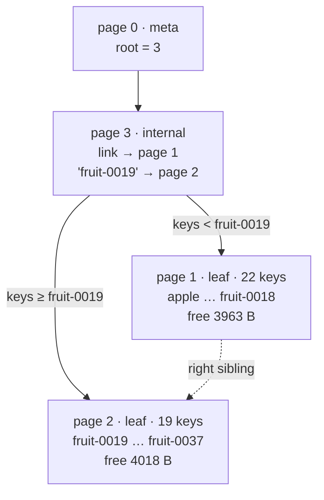

# 01. A page on disk

> Data in this chapter comes from
> `cargo run --release -p stowage-storage --example illustrate -- page`.
> Code: [`page.rs`](../../crates/storage/src/page.rs),
> [`btree.rs`](../../crates/storage/src/btree.rs),
> [`mtr.rs`](../../crates/storage/src/mtr.rs).

This chapter follows three tiny `PUT`s into an empty tree, then one more `PUT`
that no longer fits and splits the leaf. Along the way it shows:

- exactly what the bytes of an 8 KiB page look like;
- what each write appends to the WAL;
- why one split costs about 17 ordinary inserts' worth of log.

## 1.1 An empty tree is two pages and 85 bytes of log

Opening a fresh data directory creates page 0 (the meta page, which stores the
root's page id) and page 1 (an empty leaf that is the root). Both are created in one
mini-transaction, which becomes one WAL record:

```text
wal lsn 1 (85 B): next_page=2
    page 0: full image, 36 B logged (hole [44..8192) of 8148 B omitted)
    page 1: full image, 24 B logged (hole [32..8192) of 8160 B omitted)
```

A brand-new page is always logged as a **full image**, because recovery has nothing
to apply a delta to. "Full" does not mean 8 KiB, though. The empty middle of a page
(its *hole*) is left out and recreated as zeros on replay. PostgreSQL does the same
with the gap between `pd_lower` and `pd_upper`. Without that, this record would be
8233 bytes. That was the actual size before hole elision was added.

## 1.2 Three keys in one leaf

We insert `cherry=red`, then `apple=green`, then `banana=yellow`, each in its own
batch. Page 1 afterwards looks like this, as a real dump:

```text
page_id=1 kind=Leaf lsn=198 nslots=3 cell_start=8149 frag=0 link=0 free=8105
header + slot array:
  0000  c6 00 00 00 00 00 00 00 00 00 00 00 01 00 03 00  ................
  0010  d5 1f 00 00 00 00 00 00 01 00 00 00 00 00 00 00  ................
  0020  e5 1f 0e 00 d5 1f 10 00 f3 1f 0d 00              ............
cell area (end of the page):
  1fd5  06 00 06 00 62 61 6e 61 6e 61 79 65 6c 6c 6f 77  ....bananayellow
  1fe5  05 00 05 00 61 70 70 6c 65 67 72 65 65 6e 06 00  ....applegreen..
  1ff5  03 00 63 68 65 72 72 79 72 65 64                 ..cherryred
```

Decoding it field by field (little-endian):

```text
 offset  bytes          field         value
 ──────  ─────────────  ────────────  ─────────────────────────────────────────────
 0x00    c6 00 … 00     page_lsn      198 — the WAL record that last changed the page
 0x08    00 00 00 00    checksum      0 in memory; CRC32C is stamped when written out
 0x0c    01             kind          1 = Leaf
 0x0e    03 00          nslots        3
 0x10    d5 1f          cell_start    0x1fd5 = 8149: the cell area begins here
 0x12    00 00          frag          0 bytes of dead cells
 0x14    00 00 00 00    link          right sibling: none
 0x18    01 00 00 00    page_id       1
 0x20    e5 1f 0e 00    slot 0        cell at 0x1fe5, 14 bytes → apple
 0x24    d5 1f 10 00    slot 1        cell at 0x1fd5, 16 bytes → banana
 0x28    f3 1f 0d 00    slot 2        cell at 0x1ff3, 13 bytes → cherry
         ……           (hole: 8105 free bytes, all zero)
 0x1fd5  06 00 06 00 banana yellow    klen=6, vlen=6, key, value
 0x1fe5  05 00 05 00 apple green      klen=5, vlen=5
 0x1ff3  06 00 03 00 cherry red       klen=6, vlen=3
```



Two orders coexist on the page:

- **Slots are in key order** (apple, banana, cherry), so lookups binary-search the
  slot array.
- **Cells are in arrival order**, packed from the end of the page backwards. Cherry
  came first and sits at the very end. Banana came last and sits lowest.

Inserting never moves existing cells. It only shifts the slot array, 4 bytes per
slot.

## 1.3 What each insert writes to the log

Every write is a mini-transaction. The engine copies each page the first time the
mtr latches it, and at commit it diffs the page against that copy:

```text
lsn 86  (54 B on the log)   cherry: delta [14..18) 4 B, [32..35) 3 B, [8179..8192) 13 B
lsn 140 (58 B on the log)   apple:  delta [14..17) 3 B, [32..39) 7 B, [8165..8179) 14 B
lsn 198 (60 B on the log)   banana: delta [14..17) 3 B, [36..43) 7 B, [8149..8165) 16 B
```

The bytes of the last delta show what changed when `banana` landed *between* the
other two keys:

```text
000e  03 00 d5                  nslots 2→3, and the low byte of cell_start 0xe5→0xd5
0024  d5 1f 10 00 f3 1f 0d      new slot 1 (banana), and cherry's slot moved 1→2
1fd5  06 00 06 00 banana yellow the new cell
```

Each delta has three parts: header counters, a piece of the slot array, and the new
cell. The 54-byte record breaks down like this:

| Part | Bytes |
|---|---|
| frame header (length + CRC) | 8 |
| record header (kind, next_page, page count) | 7 |
| page entry (page id, tag, range count) | 7 |
| 3 ranges × 4-byte range header | 12 |
| changed bytes (4 + 3 + 13) | 20 |
| **total** | **54** |

Unchanged runs shorter than 8 bytes are folded into a neighbouring range. That is why
`[14..17)` includes byte 15, which did not change: one extra byte is cheaper than a
second 4-byte range header.

> **Why diffs and not "insert key K at slot i"?** InnoDB logs *physiological*
> records like `MLOG_REC_INSERT`. Its records are smaller when the slot array is
> long: a mid-page insert in a full leaf shifts ~120 bytes of slots. Byte diffs
> are simpler and obviously correct. Replaying them needs no B+Tree code, so a
> bug in insert logic cannot also corrupt recovery. The cost shows up in the
> benchmark in [chapter 02](02-crash-and-recover.md#25-what-durability-costs):
> deltas average ~320 B.

## 1.4 The leaf fills up and splits

Next we add `fruit-0000`, `fruit-0001`, … with 200-byte values. Each cell is
4 + 10 + 200 = 214 bytes plus a 4-byte slot, so 218 bytes per key. The 38th one does
not fit in the remaining space.

### Optimistic first, pessimistic on retry

Every write first tries the **optimistic path**:

1. Descend with shared latches.
2. Latch only the leaf, exclusively.
3. Check whether the new cell fits.

37 times it did. The 38th time the leaf has no room, so the writer drops that latch
and restarts **pessimistically**. It takes exclusive latches from the meta page
down, and drops ancestors whenever it passes a node that is *safe*, meaning it has
room for any entry, so a split below cannot propagate through it. Here the root leaf
is not safe, so the meta page stays latched as well: the split will change the
root's page id.

```text
stats: optimistic writes 40, pessimistic 1, leaf splits 1, root splits 1
```

### The tree after the split



```text
meta page: root = page 3
root  page_id=3 kind=Internal nslots=1 link=1 free=8140
      separator "fruit-0019" -> page 2 (keys >= it); link -> page 1 (keys < it)
leaf  page_id=1 kind=Leaf nslots=22 cell_start=4083 link=2 free=3963
      first key "apple", last key "fruit-0018"
leaf  page_id=2 kind=Leaf nslots=19 cell_start=4126 link=0 free=4018
      first key "fruit-0019", last key "fruit-0037"
```

How the split works:

- The 41 cells (the old 40 plus the new one) are cut where the **bytes**, not the
  key counts, are closest to half. The left side gets 22 keys because three of its
  keys are tiny.
- The separator pushed up is the first key of the right page.
- The old root leaf had no parent, so a new internal root (page 3) is allocated,
  and the meta page is repointed from 1 to 3. The tree grows from the top, and
  every leaf stays at the same depth.

## 1.5 The split's log record

All four page changes go into **one** WAL record. Recovery therefore sees either
the whole split or none of it. It can never see a new right leaf that no parent
points to.

```text
the split's mini-transaction: lsn 9687, 4331 B, 4 pages, next_page=4
  page 1: delta [14..21) 7 B, [32..41) 9 B,
                [120..191) 71 zeros (sent as a length),
                [231..4083) 3852 zeros (sent as a length),
                [8151..8192) 41 B
  page 0: delta [32..33) 1 B                                         root 1 → 3
  page 2: full image, 4166 B logged (hole [108..4126) of 4018 B omitted)
  page 3: full image, 44 B logged (hole [36..8176) of 8140 B omitted)

for comparison, an ordinary insert: lsn 258, 255 B
  page 1: delta [14..18) 4 B, [44..47) 3 B, [7935..8149) 214 B
```

Each line explained:

- **Page 1 (left half).** The left page is rebuilt in place.
  - The 19 cells that moved right leave a 3852-byte region that must become zeros:
    the hole has to be zero in memory too (§1.6).
  - That run, and the 71 zeroed bytes of the slot array, are sent as just a length.
    Before that encoding existed, this record was 8254 B.
  - The three small cells are repacked (`[8151..8192)`). The fruit cells that stay
    on the left did not move, so they cost nothing.
- **Page 2 (new right half).** A full image of a half-full page: 4166 B, the
  biggest item.
- **Page 3 (new root).** One separator, 44 B.
- **Page 0 (meta).** One byte: the root id goes from 1 to 3.

So a split costs about 17 ordinary inserts' worth of log (4331 B vs 255 B). That is
one reason B+Tree write amplification is higher than an LSM tree's, as
[chapter 02](02-crash-and-recover.md) measures.

## 1.6 A bug the simulator caught

Hole elision rests on one invariant: **the hole is all zeros in memory, too.** The
first version did not maintain it. `remove_cell` left the old cell's bytes in the
gap. Then this happened:

1. Memory: the hole holds stale bytes `X`. The WAL image: zeros (hole omitted).
2. A later insert writes a cell whose bytes at some offset happen to equal `X`.
3. The diff sees "no change" there and logs nothing for those bytes.
4. Recovery replays image (zeros) + delta (without those bytes) → a different page.

The torn-crash simulation (`crates/storage/tests/simulation.rs`, see chapter 02)
failed 0.27 s into its run with an out-of-bounds slot index. The fix:

- `remove_cell` zeroes the bytes it returns to the hole;
- a `debug_assert!(page.hole_is_zero())` guards every image the WAL encodes.

## 1.7 Readers during all this

A reader never sees a half-done split. It crabs down with shared latches: latch the
child, then release the parent. During the split, the writer holds exclusive latches
on every page the split changes (here: meta, page 1, and the new pages 2 and 3). A
reader is therefore either already past the leaf before the split began, or waits
above it and sees the result.

Scans copy one leaf's matching entries and then **re-descend from the root** for
the next leaf, instead of trusting a sibling pointer remembered from earlier. A
split that moves keys to a new right page between two `next()` calls therefore
cannot make the scan skip them.

`tests/concurrency.rs` checks exactly this:

- one writer grows the tree to 6000 keys;
- 4 readers scan and point-read the whole time, on a 64-page buffer pool, so
  readers are constantly evicting pages the writer just dirtied;
- every full scan must contain every key committed before it started, strictly
  ordered, and no reader may see a key's version go backwards.
