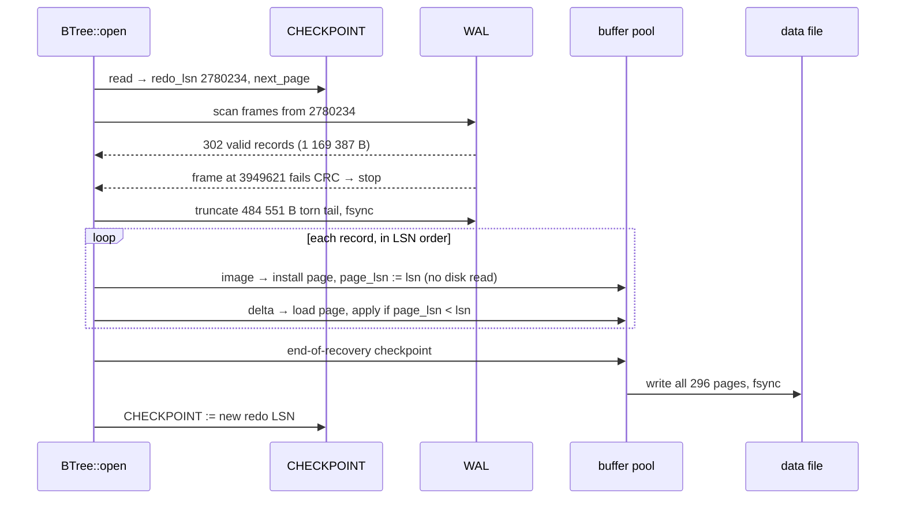

# 02. Crash and recover

> Data in this chapter comes from
> `cargo run --release -p stowage-storage --example illustrate -- crash`
> (simulated power loss), from
> `cargo run --release -p stowage-storage --example crashtest -- loop --iterations 200`
> (real `kill -9`), and from `stow-bench engine` (§2.5).
> Code: [`wal.rs`](../../crates/storage/src/wal.rs),
> [`mtr.rs`](../../crates/storage/src/mtr.rs),
> [`checkpoint.rs`](../../crates/storage/src/checkpoint.rs),
> [`btree.rs`](../../crates/storage/src/btree.rs) (`BTree::open`).

This chapter cuts the power in the middle of a busy B+Tree, looks at the wreckage on
disk byte by byte, and then follows recovery as it puts the tree back together. The
recovered tree must contain every write the engine acknowledged, and nothing
half-done.

## 2.1 The rules that make recovery possible

| Rule | Where | Why |
|---|---|---|
| **WAL before page.** A dirty page is written back only after the WAL is durable up to the page's LSN. | `BufferPool::write_back` | A page on disk never holds a change whose log record could vanish. |
| **One mtr = one record.** A whole `WriteBatch` (and any splits it causes) is one WAL record. | `BTree::commit` | Recovery sees all of a split or none of it. |
| **Image on first touch.** The first change to a page after a checkpoint logs the full page (minus its hole). Later changes log byte deltas. | `BTree::commit` (`before.lsn() < redo`) | A page torn mid-write can be rebuilt from the image, with no need to read the torn copy. |
| **Delta only if newer.** Replay applies a delta only if `page_lsn < record_lsn`. | `BTree::open` | Replay is idempotent. A crash *during* recovery is harmless. |
| **Checkpoint pointer outside the data file.** `CHECKPOINT` is replaced by write-tmp → fsync → rename → fsync-dir. | `checkpoint.rs` | A torn page 0 can never lose the recovery start point. |

## 2.2 The scenario

The run (`crash_scenario`, simulator seed 0) has three phases:

1. **Before the checkpoint.** Insert 10 000 keys, then take a checkpoint. All pages
   are flushed and fsynced, and recovery will start at the checkpoint's redo LSN.
2. **Acknowledged updates.** 300 synced updates spread across the tree. The pool
   has only 64 frames, so these updates keep evicting pages. Each write-back
   happens *without* an fsync, so a crash may tear it.
3. **Unsynced tail.** 600 *unsynced* 1500-byte updates to 20 hot keys. The hot
   pages stay cached, so no eviction forces the WAL to disk. Once more than
   64 KiB is buffered, the WAL writes it to the file without an fsync, the way
   PostgreSQL writes out full WAL buffers.

Then power is cut in `CrashMode::Torn`. Each write since its file's last fsync
independently survives whole, is torn at a 512-byte sector boundary, or is lost.

```text
== before the crash
checkpoint redo LSN: 2780234
WAL end 4467309 · durable (fsynced) up to 3941939 · acked writes end at 3941939
pages written back by eviction after the checkpoint (no fsync): 515
```

## 2.3 The wreckage

```text
== on disk right after the power cut
data file: 270 pages valid, 0 all-zero, 26 torn (checksum mismatch):
           [12, 14, 15, 48, 52, 56, 60, 68, 69, 81, 83, 116, 141, 152, 153, 155,
            156, 163, 171, 175, 178, 181, 187, 195, 211, 216]
WAL bytes present: 1653938 (from the checkpoint segment on)
```

The WAL as a byte stream, starting at the checkpoint:

```text
 LSN 2780234                         3941939                  4434172      4467309
 │◄──────── fsynced: 1 161 705 B ──────►│◄─ in the file, never ─►│◄─ only in ─►│
 │  300 acknowledged updates            │  fsynced: 492 233 B    │  memory     │
 │  (+ page images, first touch)        │  torn by the crash     │  (lost)     │
 ▼                                      ▼                        ▼             ▼
 ████████████████████████████████████████▓▓▓▒▒░░  ░  ░░ ▒   ░░░░               end
```

And 26 of the 515 page write-backs since the checkpoint left a torn page (5 %): the
first *k* sectors are new, the rest are old, and the CRC32C no longer matches. An
engine that trusted the data file alone would have lost 26 pages of the tree.

## 2.4 Recovery, step by step



```text
== recovery report
RecoveryReport {
    checkpoint: Some(2780234),
    records: 302,
    wal_bytes: 1169387,
    images: 274,
    deltas_applied: 28,
    deltas_skipped: 0,
    torn_tail_bytes: 484551,
    end_lsn: 3949621,
    next_page: 296,
    created: false,
}
```

What happened:

- **Finding the end.** The scan stopped at LSN 3949621, the first frame whose CRC
  (which covers the frame's own LSN) fails. Everything after it, 484 551 bytes, is
  the torn tail. It is truncated, so new records start at a clean boundary.
  3949621 is a little past the durable point 3941939. Two of the unsynced hot-key
  updates happened to survive whole, and recovery keeps them. That is allowed:
  they were never acknowledged, so keeping them or losing them are both correct.
- **Repairing torn pages.** Every one of the 26 torn pages was modified after the
  checkpoint (that is why eviction wrote it). Its first post-checkpoint change was
  therefore logged as a full image, and the image is replayed before any delta for
  that page. Recovery never reads the torn copies: 274 images were installed
  without touching the data file at all.
- **28 deltas** were applied on top of those images. None were skipped. A skip
  would mean a page on disk already had the change, which happens when recovery
  itself crashes and runs again.
- **End-of-recovery checkpoint.** It writes all 296 pages and moves `CHECKPOINT`
  forward, so the next crash does not replay this window again.

```text
== after recovery
acknowledged updates present: 300/300
hot keys whose unsynced 1500-byte update survived: 2/20
structural check: 10002 keys, height 2
data file after the end-of-recovery checkpoint: 296 valid, 0 torn
```

`10002` is the 10 000 original keys plus the two hot keys whose insert survived.
`BTree::check` also verifies key order inside every page and against parent
separators, uniform leaf depth, and that the sibling chain visits exactly the
leaves the tree reaches.

## 2.5 What durability costs

Everything above has a price, paid in log bytes and page writes. `stow-bench
engine` loads 500 000 random 20-byte keys with 100-byte values (57.2 MiB of user
data) into a B+Tree with a 32 MiB buffer pool, single-threaded, on an M3 Pro. Then
it counts every byte written. Each row changes one thing relative to the row above
it:

| Configuration | WAL | full-page images | page write-backs | write amplification |
|---|---:|---:|---:|---:|
| first version: images include the hole · checkpoint every 64 MiB of WAL | 1658.5 MiB | 197 384 × 8 KiB | 269 902 | **65.8×** |
| + hole elision and zero-run deltas | 409.9 MiB | 51 173 × 5.9 KB | 266 090 | 43.5× |
| + checkpoint every 256 MiB (the new default) | 172.6 MiB | 10 237 × 4.1 KB | 262 010 | 38.8× |
| + a 256 MiB pool (the whole 80 MiB tree fits) | 172.6 MiB | 10 237 × 4.1 KB | 10 237 | **4.4×** |

"Write amplification" here means `(WAL bytes + page write-backs × 8 KiB) ÷ user
bytes`.

**Images scale with checkpoints.** After each checkpoint, the next change to
*every* page logs that page's image again. With 10 237 pages and a 64 MiB interval,
the images alone filled most of every interval, so the engine spent its log budget
re-logging pages, which triggered the next checkpoint sooner. Leaving out the hole
roughly halved each image. A 4× longer interval cut the number of images 5×, at the
price of up to 4× more WAL to replay after a crash. PostgreSQL makes the same
trade with `max_wal_size` and `checkpoint_timeout`.

**Write-backs scale with cache misses.** With 80 MiB of pages and 32 MiB of cache,
almost every random insert lands on a page that is not cached. Making room for it
evicts a dirty page: one 8 KiB write per ~100-byte insert. Once the tree fits in
the pool, write-backs drop to one per page (at the final checkpoint), and write
amplification drops from 38.8× to 4.4×.

That second effect is the core difference from an LSM tree, which never updates in
place. Same workloads, same cache budgets ([fjall](https://crates.io/crates/fjall)
behind the same `Engine` trait):

| 500 k keys, single thread | B+Tree, 32 MiB | LSM, 32 MiB | B+Tree, 256 MiB | LSM, 256 MiB |
|---|---:|---:|---:|---:|
| random insert, ops/s | 76 452 | **239 300** | 167 422 | **315 136** |
| point get, ops/s (p99) | **189 359** (18.3 µs) | 138 792 (20.5 µs) | **931 132** (1.6 µs) | 331 922 (6.3 µs) |
| get of a missing key, ops/s | **2 256 932** | 968 722 | 2 650 357 | **3 417 591** |
| scan 100 keys, ops/s (p99) | **57 822** (36.8 µs) | 13 950 (270 µs) | **85 159** (18.9 µs) | 36 601 (34.9 µs) |
| update + fsync, ops/s (p50) | 194 (5.0 ms) | 218 (4.1 ms) | 224 (4.3 ms) | 221 (4.1 ms) |
| on-disk size / user data | **1.40×** | 2.16× | **1.40×** | 2.16× |

The textbook trade-off, measured:

- The **LSM** writes 2–3× faster: an insert is a memtable insert plus a journal
  append, with no page to fetch or evict.
- The **B+Tree** reads 1.4–2.8× faster: one root-to-leaf path instead of several
  levels.
- Its scans are 2–4× faster: keys sit contiguously in leaves, instead of being
  merged from several sorted runs.
- It uses less space: no stale versions are waiting for compaction.
- The LSM wins missing-key lookups once its bloom filters are cached (256 MiB).
- Synchronous commits cost the same for both. They are bound by fsync on APFS
  (~4–5 ms), which is why the layers above batch many writes into one fsync (Raft
  log batching, M2).

Stowage's storage engine sits under a Raft state machine that applies committed
entries in order, and above it the SQL layer needs fast point reads and range
scans for indexes. That workload favours the B+Tree. The LSM adapter stays in the
tree as the comparison baseline.

These are single runs on a laptop, and repeat runs of the same configuration
varied by up to 2× (scans were the noisiest). Compare ratios within a table, not
absolute numbers across tables. Full output: [`docs/benchmarks.md`](../benchmarks.md).

## 2.6 How this is tested

| Test | What it does | Result at this commit |
|---|---|---|
| `tests/simulation.rs` `recovers_a_prefix_after_every_torn_crash` | 8 fixed seeds × 25 rounds of random batches (puts, deletes, 0–900 B values, 20 % synced), each round ending in a `Torn` power cut. After recovery, the tree must equal the model after **exactly some batch n** with `acked ≤ n ≤ issued`. That covers durability, atomicity and the prefix property in one assertion. | 200 crashes, 0 violations. Also run with `STOWAGE_SIM_SEEDS=100`: 2 700 crashes, 0 violations. CI adds 100 fresh seeds per push. |
| `tests/simulation.rs` `crash_test_exercises_torn_tails_and_lost_tails` | Asserts that the fixed seeds actually hit torn WAL tails and lost unsynced batches, so the test above is not passing vacuously. | ✅ |
| `examples/crashtest.rs` | Real processes on APFS. The child writes synced batches and prints `ack n`; the parent sends `SIGKILL` after 20–300 ms, reopens, and checks the same prefix property against a deterministic model. | 200 `kill -9` crashes, 0 violations; slowest recovery 55.6 ms (M3 Pro). |
| `src/wal.rs` tests | Torn tail truncation over 100 seeds, segment rotation and removal. | ✅ |
| `src/mtr.rs` proptests | Decoding arbitrary bytes never panics; truncated records are rejected; diff + apply reproduces the page. | ✅ |
| `tests/btree.rs` proptest | Random puts/deletes/checkpoints/reopens against a `BTreeMap` model, with a 16-frame pool that forces constant eviction. | ✅ |

A `kill -9` keeps the OS page cache, so unsynced writes usually still reach the disk.
It tests *process* crashes. Power loss, where unsynced data is torn or lost, is what
the simulator models, because a laptop cannot be unplugged 2 700 times.

Fuzzing with `cargo-fuzz` needs a nightly toolchain and is not set up yet. The
decoder proptests above cover the same property (no panic on arbitrary input) on
stable.
