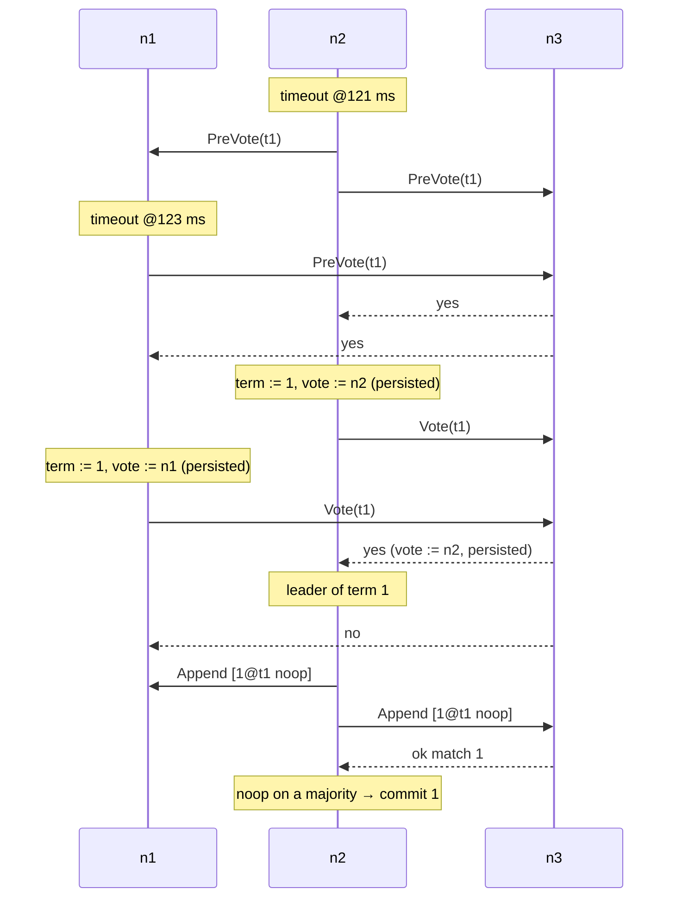

# 03. One write through Raft

> Data in this chapter comes from `cargo run -p stowage-raft --example trace_put`
> (simulator seed 3). Three nodes run a key-value store on Raft, each with its own
> `DiskStorage` on a simulated disk, connected by links with 0.5–5 ms latency.
> Times are virtual milliseconds. Code: [`raft.rs`](../../crates/raft/src/raft.rs),
> [`storage.rs`](../../crates/raft/src/storage.rs), test harness
> [`tests/common/kv.rs`](../../crates/raft/tests/common/kv.rs).

This chapter follows four things through a Raft group, message by message:

1. the group electing its first leader;
2. one `PUT`;
3. one linearizable `GET`;
4. a write stranded on the wrong side of a partition.

It ends with how we know the implementation is right: six classic Raft bugs,
planted on purpose, and the tests that catch each one.

## 3.1 Electing the first leader

All three nodes start as followers with empty logs. Each picks a random election
timeout between 10 and 20 ticks (100–200 ms). Two of them happen to time out
within 2 ms of each other:

```text
  121.482ms recv n2->n1 t1 PreVote(last 0@t0)       ← n2 timed out first
  122.903ms recv n2->n3 t1 PreVote(last 0@t0)
  123.383ms recv n1->n3 t1 PreVote(last 0@t0)       ← n1 timed out too
  123.608ms recv n1->n2 t1 PreVote(last 0@t0)
  123.893ms recv n1->n2 t1 PreVoteResp(yes)
  124.828ms recv n3->n1 t1 PreVoteResp(yes)
  125.201ms recv n3->n2 t1 PreVoteResp(yes)         ← n2 has a pre-vote majority
  125.271ms recv n2->n3 t1 Vote(last 0@t0)          ← n2 now really campaigns, term 1
  127.328ms recv n2->n1 t1 PreVoteResp(yes)
  128.388ms recv n1->n3 t1 Vote(last 0@t0)          ← n1 also reached a pre-vote majority
  128.633ms recv n2->n1 t1 Vote(last 0@t0)
  128.673ms recv n3->n2 t1 VoteResp(yes)            ← n3 voted for n2 first: n2 wins
  129.483ms recv n1->n2 t1 Vote(last 0@t0)
  129.669ms recv n2->n1 t1 Append(prev 0@t0 [1@t1 noop] commit 0)
  129.693ms recv n2->n3 t1 Append(prev 0@t0 [1@t1 noop] commit 0)
  130.501ms recv n2->n1 t1 VoteResp(no)             ← n2 already voted for itself
  132.218ms recv n1->n2 t1 VoteResp(no)
  132.283ms recv n3->n1 t1 VoteResp(no)             ← n3 already voted for n2
  133.381ms recv n3->n2 t1 AppendResp(ok match 1)
  134.208ms recv n1->n2 t1 AppendResp(ok match 1)
  142.801ms recv n2->n3 t1 Heartbeat(commit 1 ctx 0 round 1)
```



Points worth noticing:

- **Pre-vote first.** A pre-vote asks "would you vote for me in term 1?" without
  changing anyone's term. Only after a majority says yes does a node increment its
  term and ask for real votes. Section 3.4 shows why this matters.
- **The split vote resolved itself.** n1 and n2 both campaigned in term 1. A node
  grants at most one vote per term, and that vote is **persisted before the reply
  is sent**. n3's vote went to whichever request arrived first: n2's, at 125.3 ms,
  3 ms ahead of n1's. One vote per term per node means at most one leader per term.
- **The no-op.** A new leader's first act is to append an empty entry in its own
  term. A leader may only count replicas to commit entries of *its own* term (3.6
  shows what goes wrong otherwise). The no-op is how it gets one committed
  quickly, which also commits everything before it.

Time from the first timeout to a committed no-op: 133.4 − 121.5 ≈ 12 ms.

## 3.2 One PUT

A client sends `PUT k7=42` to n2:

```text
  346.088ms recv n0->n2 Req(c1#1 Put(7, 42))
                 n2: append [2@t1] to its log, fsync, then send to both followers
  346.617ms recv n2->n1 t1 Append(prev 1@t1 [2@t1 cmd 26B] commit 1)
  348.018ms recv n2->n3 t1 Append(prev 1@t1 [2@t1 cmd 26B] commit 1)
                 each follower: check prev 1@t1 matches, append, fsync, reply
  350.739ms recv n1->n2 t1 AppendResp(ok match 2)     ← n2 + n1 = majority of 3
                 n2: commit := 2, apply k7=42, answer the client
  352.445ms recv n3->n2 t1 AppendResp(ok match 2)     ← not needed
  353.118ms recv n2->client Resp(c1#1 Ok(None))

latency: 9.445 ms (client → leader → quorum fsync → apply → client)
n1: commit 2 applied 2 last 2 log fsyncs 4 kv {7: 42}
n2: commit 2 applied 2 last 2 log fsyncs 4 kv {7: 42}
n3: commit 2 applied 2 last 2 log fsyncs 4 kv {7: 42}
```

```text
 client        n2 (leader)                 n1                     n3
   │ Put ─────────►│ log[2]=Put, fsync        │                      │
   │   0.0 ms      │── Append(prev 1@t1) ────►│ match? yes, append,  │
   │               │── Append(prev 1@t1) ─────┼─────────────────────►│ fsync
   │               │◄─────── ok match 2 ──────│                      │
   │               │ 2 of 3 have index 2 ⇒ commit=2 ⇒ apply          │
   │◄──── Ok ──────│  9.4 ms                  │                      │
   │               │◄─────────────── ok match 2 ─────────────────────│ (late; ignored)
```

The `Append` names its predecessor: `prev 1@t1` means "this entry goes after index 1,
which must be from term 1 in your log". A follower whose log disagrees refuses
the entry. That one check maintains the **Log Matching** property: if two logs
agree on an index and term, they agree on everything before it.

The `commit 1` in the `Append` is the leader's commit index *when it sent the
message*. The followers learn that index 2 committed from the next message they
receive: at the latest the next heartbeat, which goes out every 2 ticks (20 ms).
The client does not wait for that.

**The 4 fsyncs per node**:

- n2 (the leader) wrote its term and vote, which costs 2 syncs: the temp file and
  the directory. It then fsynced the no-op and the PUT.
- n1 also campaigned in term 1, so it also persisted a term and vote, plus the two
  entries.
- n3 persisted the new term and its vote for n2 as **one** atomic write, plus the
  two entries.

An earlier version persisted n3's term change and its vote as two separate writes
(6 fsyncs). The hard state is now marked dirty and flushed once at the end of each
`step`, before any message can be taken from the node. This is etcd's "one
persist per Ready".

The simulator's fsync takes zero virtual time. On the laptop SSD from
[chapter 02](02-crash-and-recover.md#25-what-durability-costs), an fsync costs about
4–5 ms, and the leader's fsync and a follower's fsync are both on the path. That is
why the layer above (M3) puts many client writes into one `propose(batch)`: one
entry, one fsync, many writes.

## 3.3 One linearizable GET, without touching the log

A read served from the leader's state machine could be stale. The node may have
been deposed a moment ago without knowing it. Writing the read into the log
would be correct but costs a replication round and an fsync. **ReadIndex** costs
one heartbeat round and no disk write:

```text
  482.973ms recv n0->n2 Req(c1#2 Get(7))
                 n2: read_index := commit (2); ctx := 1; heartbeat now with ctx 1
  483.621ms recv n2->n1 t1 Heartbeat(commit 2 ctx 1 round 19)
  484.478ms recv n2->n3 t1 Heartbeat(commit 2 ctx 1 round 19)
  486.144ms recv n1->n2 t1 HeartbeatResp(ctx 1 round 19)   ← n2 + n1: still leader
                 n2: applied (2) ≥ read_index (2) → read k7 from the state machine
  489.307ms recv n3->n2 t1 HeartbeatResp(ctx 1 round 19)
  490.323ms recv n2->client Resp(c1#2 Ok(Some(42)))
```

Three rules make this safe:

1. **A majority heard from n2 after the read arrived.** No other leader can have
   committed anything newer at that moment. (Responses carrying older `ctx` values,
   like the round-18 replies in the full trace, do not count for this read.)
2. **The read index is the commit index when the read arrived.** The answer is
   returned only after the state machine has applied at least that far.
3. **The leader must have committed an entry in its own term first** (its no-op),
   or its commit index could lag entries committed by its predecessor. Reads that
   arrive earlier wait in `reads_before_commit`. §3.6 shows the stale read when
   this rule is removed.

`ReadMode::Lease` skips the heartbeat round as well. While a quorum acknowledged a
heartbeat sent less than `election_ticks − 2` ticks ago, the leader answers
immediately. This is safe only because followers that heard from a leader within
an election timeout **refuse to vote** for anyone else ("leader stickiness"). It
also relies on all clocks ticking at about the same *rate*.

## 3.4 A write on the wrong side of a partition

At 590.7 ms the leader n2 is cut off from n1 and n3. A client's `PUT k7=99` has
just reached it:

```text
  590.673ms partition [2] | [1, 3]
  591.356ms cut n2->n1 t1 Append(prev 2@t1 [3@t1 cmd 26B] commit 2)
  591.356ms cut n2->n3 t1 Append(prev 2@t1 [3@t1 cmd 26B] commit 2)
  600.000ms cut n2->n1 t1 Heartbeat(commit 2 ctx 0 round 25)
  …          (n2 keeps heartbeating into the void)
  680.000ms cut n1->n2 t2 PreVote(last 2@t1)          ← the majority side elects n1 in term 2

n2: role PreCandidate term 1 commit 2 (was 2) last 3 — the PUT sits uncommitted
majority side: new leader Some(1); n1 term 2 n3 term 2
replies to client 2 while isolated: 0
after healing: n2 role Follower term 2 commit 3 last 3 kv {7: 42}; its index 3 is now Some((2, "noop"))
```

This is the **CP** in [ADR 0003](../adr/0003-layered-cp-architecture.md):

- **The minority side commits nothing.** n2 has index 3 in its log but can never
  get a second copy, so its commit index stays at 2 and the client gets no answer.
  A client that retries against the majority side gets a definite answer there.
  The companion AP store, Cartwheel, would have accepted the write on both sides
  and reconciled later.
- **Check-quorum.** After an election timeout without hearing from a majority, n2
  steps down by itself. It stops serving lease reads it can no longer justify.
- **Pre-vote keeps the term from inflating.** Isolated, n2 times out again and
  again, but each attempt is only a pre-vote, which nobody receives. Its term stays
  1. Without pre-vote it would reach term 2, then 3, then 4…; on healing, its high
  term would force the healthy leader n1 to step down for nothing.
- **Healing.** n2 hears from n1 in term 2 and becomes a follower. Its uncommitted
  index 3 (term 1, the PUT) conflicts with n1's index 3 (term 2, n1's no-op), so it
  is replaced. The dump shows exactly that, and k7 is still 42.

## 3.5 Many writes, many failures

The trace above is one hand-picked seed. `tests/simulation.rs` runs the same
store under hostile conditions and checks the results mechanically:

| Test | Fault model | Checked |
|---|---|---|
| `linearizable_under_chaos_*` | 5 nodes, 8 clients, 3 % message loss, 2 % duplication; every 400 ms a random bisection, isolated leader, crash, restart or heal; up to 2 nodes down | the client history per key is **linearizable** (Porcupine-style checker in `stowage-sim`); at most one leader per term; all nodes apply identical entries at each index |
| `linearizable_under_leader_churn_*` | 10 % loss, 5 % duplication; every 60–200 ms the leader is crashed, or cut off from a *random subset* of followers (non-transitive partitions), or a random node dies; 70 % of dead nodes restart at once | same, with ReadIndex and with lease reads |
| `membership_change_under_load` | {1,2,3} → {1,2,3,4,5} → {3,4,5} by joint consensus while clients write, with the old leader crashed after each change | linearizability; the final leader is in {3,4,5} |
| `lagging_node_catches_up_by_snapshot` | a follower is down while the log is compacted every 16 entries | it converges via `InstallSnapshot` |
| `leadership_transfer_moves_the_leader` | `transfer_leadership` → `TimeoutNow` | the target leads within 300 ms |
| `minority_side_cannot_commit` | §3.4 with five nodes | the old leader steps down, its commit index does not move |

At this commit, all of them pass on the fixed seeds and on 200 extra random seeds
(`STOWAGE_SIM_SEEDS=200`, 49 s in release mode).

## 3.6 Do the tests actually catch Raft bugs?

A suite that always passes might be checking nothing. So we planted six well-known
Raft bugs, one at a time, and ran the suite against each (with 20 random seeds on
top of the fixed ones):

| Planted bug | First round: simulator only | After adding scenario tests | Caught by |
|---|---|---|---|
| **Figure 8**: commit an old-term entry by counting replicas | missed | **caught** | `figure_8_old_term_entry_is_not_committed_by_counting` |
| **Vote not durable** before the reply is sent | missed | **caught** | `vote_survives_a_crash`: "two leaders in term 1: [(1, 1), (2, 1)]" |
| **No leader stickiness** with lease reads | missed | **caught** | `lease_read_is_not_stale_under_partial_partition` |
| Serve reads **before the own-term commit** | caught | caught | chaos and churn tests: "history … is not linearizable" |
| **No election restriction** (vote for any log) | caught | caught | oracle: "node 5 applied a different entry at index 144" |
| **No log-matching check** on `Append` | caught | caught | oracle + Figure 8 scenario |

The three bugs the random simulator missed each need a precise interleaving:

- **Figure 8** needs an old-term entry on a majority while the new leader's own
  entry is on almost nobody, followed by a crash at exactly that moment.
- **A lost vote** needs a voter to crash between voting and the end of the same
  election, and then receive a request from a second candidate in that term.
- **A stale lease read** needs a non-transitive partition: some followers still
  hear from the old leader while also hearing from a candidate.

Making the random nemesis harsher (leader churn, partial partitions) did not find
them in 20 seeds. Hand-scripted scenarios, as in etcd/raft's test suite, do it
deterministically. `tests/scenarios.rs` replays the paper's Figure 8 step by step
on a 5-node cluster:

1. S1 replicates index 2 to S2 only.
2. S5 wins term 2 without S1 or S2.
3. S1 wins term 3, and index 2 reaches S3, while the term-3 no-op is lost in
   flight.

At that moment S1 must not commit index 2. Otherwise S5 wins term 4 next (its last
entry, from term 2, beats term 1) and overwrites index 2 on every node.

The final run of the six mutants: **6 / 6 caught**
(`python3 scripts/raft-mutants.py` reproduces it).

One detail of the vote mutant. In the first round it deleted the
`persist_hard_state()` call next to `vote = Some(..)`. After hard-state writes were
coalesced (§3.2), that deletion stopped mattering on the path the scenario takes:
the same `step` also changed the term, and the flush at its end writes term *and*
vote together. The mutant was therefore retargeted at the flush itself, the one
place where hard state reaches the disk. A vote granted in an already-known term
without any term change is the case the per-site deletion would still break; no
test covers that path yet.

## 3.7 Bugs the suite found in this implementation

- **A false "stall" that resent every write.** The leader decides that an `Append`
  was lost when a follower's match index has not moved between heartbeats. The
  first trace of §3.2 showed every `PUT` sent twice. A reply to a heartbeat sent
  just *before* the write arrived just *after* it, so the leader saw "no progress"
  and fell back to probing. The fix was to call a follower stalled only when it is
  behind and both its last send and its last reply are two heartbeat intervals old.
- **…and the fix's own bug.** The fix first compared "last reply tick < last send
  tick". The leader-churn test then hung on seed 61 with followers stuck behind
  forever. A reply and the next send often fall in the *same* tick, and if that
  send is lost, `<` never becomes true. The dump the test prints on a hang showed
  the leader at index 1647 and every follower in the 440s.
