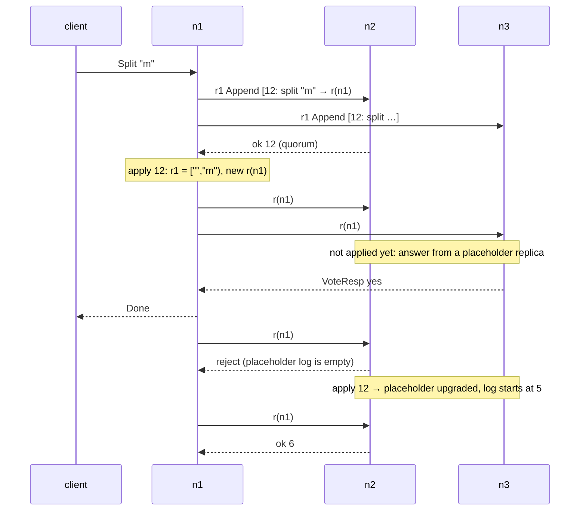

# 04. A range splits

> Data in this chapter comes from
> `cargo run --release -p stowage-kv --example trace_split`
> (the simulator, seeds 4 and 9) and from `stow-bench kv` against a real
> three-node cluster (§4.6). Code: [`store.rs`](../../crates/kv/src/store.rs),
> [`routing.rs`](../../crates/kv/src/routing.rs),
> [`log_engine.rs`](../../crates/raft/src/log_engine.rs),
> [`server.rs`](../../crates/node/src/server.rs). Design:
> [ADR 0006](../adr/0006-multi-raft-ranges.md).

One Raft group cannot hold the whole key space, so Stowage cuts it into
**ranges**, each its own Raft group. This chapter follows:

1. one range splitting in two;
2. a replica moving to a new node;
3. a client finding its way afterwards;
4. what that costs on real disks;
5. the bugs the simulator found in the seams between ranges.

## 4.1 Where the data lives

A node runs one `Store`: every range replica it holds, on top of **one** storage
engine and **one** Raft log.

```text
 node n1
 ┌──────────────────────────────────────────────────────────────────────────┐
 │  replicas:  r1 ["", "m")      r(n1)#1 ["m", ∞)      …                    │
 │             Raft group        Raft group                                 │
 │                 │                 │                                      │
 │                 ▼                 ▼                                      │
 │  shared Raft log  raftlog-00000000.log  ── one fsync per batch, all ranges│
 │                                                                          │
 │  storage engine (B+Tree, chapter 01):                                    │
 │      'd' ‖ user key         → value          (all ranges' data)          │
 │      'l' ‖ "desc"  ‖ id     → descriptor     [start, end), replicas, gen │
 │      'l' ‖ "applied" ‖ id   → applied index                              │
 └──────────────────────────────────────────────────────────────────────────┘
```

A range owns no files, only a span of `'d'` keys. Hence the key fact of this
chapter: **a split moves no data**.

## 4.2 One split, message by message

There are three nodes and one range r1 = `["", ∞)` led by n1, with five keys in it.
A client asks n1 to split at `"m"`:

```text
 1050.782ms recv n0->n1 Client#1 Split { key: "m" }
 1052.862ms recv n1->n2 r1 t6 Append(prev 11, [12:split at "m" → r(n1)#1], commit 11)
 1053.152ms recv n1->n3 r1 t6 Append(prev 11, [12:split at "m" → r(n1)#1], commit 11)
 1055.213ms recv n2->n1 r1 t6 AppendResp(ok 12)          ← quorum: the split is committed
                n1 applies it: r1 := ["", "m"), creates r(n1)#1 := ["m", ∞)
 1057.237ms recv n1->n2 r(n1)#1 t6 Vote { last_index: 5, last_term: 5, force: true }
 1057.324ms recv n1->n3 r(n1)#1 t6 Vote { last_index: 5, last_term: 5, force: true }
 1057.936ms recv n3->n1 r(n1)#1 t6 VoteResp { granted: true }   ← n1 leads the new range
 1058.215ms recv n1->client Reply#1 Done                          ← 7.4 ms after the request
 1061.438ms recv n1->n3 r(n1)#1 t6 Append(prev 5, [6:noop], commit 5)
 1064.137ms recv n3->n1 r(n1)#1 t6 AppendResp(reject Some(ConflictHint { term: None, first_index: 1 }))
 1064.270ms recv n2->n1 r(n1)#1 t6 AppendResp(reject Some(ConflictHint { term: None, first_index: 1 }))
 1066.284ms recv n1->n2 r(n1)#1 t6 Append(prev 5, [6:noop], commit 5)
 1069.496ms recv n3->n1 r(n1)#1 t6 AppendResp(ok 6)
 1070.326ms recv n2->n1 r(n1)#1 t6 AppendResp(ok 6)
```



Step by step:

1. **The split is an ordinary Raft command.** It is ordered among r1's writes like
   any other entry. Every replica applies it at index 12, and in the same engine
   batch it rewrites r1's descriptor and writes the new one. The batch is fsynced,
   because the new range's Raft state is about to exist (§4.7, bug 8).
2. **The new range starts at index 5, term 5**, as a placeholder snapshot with no
   data. Every replica that applies the split creates exactly this state, so the
   replicas already agree without any data being sent.
3. **The left half's leader campaigns immediately** for the right half (a `force`
   vote, as in leadership transfer). It does not wait 100–200 ms for an election
   timeout: the new range has a leader 2.7 ms after the split commits (1057.9 ms),
   and that leader's no-op commits about 14 ms after the split (1069.5 ms).
4. **n2 and n3 hear about the new range before they have applied the split.** The
   commit index reaches them only with n1's next message. Each answers from an
   *uninitialized placeholder replica*: it can vote, and it persists that vote, but
   it holds no data and applies nothing. Its empty log rejects the first
   `Append`. Once n2 and n3 apply index 12, the placeholder is **upgraded in place**
   (its files and its vote are kept). The leader's next probe, sent at the
   compaction boundary (index 5) before it would ever resort to a snapshot,
   succeeds.

Afterwards, every node holds the same three keys for the new range: no data
moved.

```text
after:
  n1: r(n1)#1 ["m",∞) gen 2 LEADER {1, 2, 3} applied 6 | r1 ["","m") gen 2 LEADER {1, 2, 3} applied 12
  n2: r(n1)#1 ["m",∞) gen 2 {1, 2, 3} applied 6        | r1 ["","m") gen 2 {1, 2, 3} applied 12
  n3: r(n1)#1 ["m",∞) gen 2 {1, 2, 3} applied 6        | r1 ["","m") gen 2 {1, 2, 3} applied 12

  n1 holds 3 pairs for r(n1)#1 — no data moved: ["melon", "peach", "zucchini"]
  n2 holds 3 pairs for r(n1)#1 — no data moved: ["melon", "peach", "zucchini"]
  n3 holds 3 pairs for r(n1)#1 — no data moved: ["melon", "peach", "zucchini"]
```

The new id `r(n1)#1` is `(1 << 40) | 1`: node 1's first allocation. Each node
counts in its own space and persists the counter before using it, so ids are
unique without a central allocator.

## 4.3 A replica moves

A fourth node joins, holding nothing. The scheduler runs on whichever node leads
r1. It sees n4 with 0 replicas against 2 on the others, and moves one r1 replica
from n2 to n4. It does this with **one** joint-consensus change,
`{1,2,3} → {1,3,4}`:

```text
 1302.655ms recv n1->n3 r1 t6 Append(prev 12, [13:config joint {1, 2, 3}→{1, 3, 4}], commit 12)
 1303.323ms recv n1->n2 r1 t6 Append(prev 12, [13:config joint {1, 2, 3}→{1, 3, 4}], commit 12)
 1307.017ms recv n1->n3 r1 t6 Append(prev 13, [14:config {1, 3, 4}], commit 13)
 1309.766ms recv n1->n4 r1 t6 Append(prev 5, [6:noop, 7:write ["apple"], …, 12:split at "m" → r(n1)#1,
                                         13:config joint {1, 2, 3}→{1, 3, 4}, 14:config {1, 3, 4}], commit 13)
 1315.866ms recv n1->n2 Gc { range: 1, generation: 4 }
 1317.220ms recv n1->n4 r1 t6 InstallSnapshot(@14 t6, 2 pairs, 86 B)
```

What happened, in order:

1. **Joint configuration.** Index 13 makes both the old and the new set vote.
   Every decision needs a majority of `{1,2,3}` *and* a majority of `{1,3,4}`.
   Once that entry commits, the leader appends `C_new` (index 14) by itself.
2. **Catching up n4.** n4 has nothing, so its first reply sends the leader into
   probing. The probe at the compaction boundary (prev 5) also fails, because n4's
   log is empty. The leader then asks the store for a snapshot, and the store
   **generates it right then**: the descriptor plus every pair in r1's span, as of
   the applied index (14). That is 2 pairs and 86 bytes.
3. **Removing n2.** Once `C_new` is applied, the leader tells the removed replica
   to garbage-collect itself (`Gc`, generation 4). n2's replica deletes its data in
   r1's span and drops its group from the shared log.

```text
after:
  n1: r(n1)#1 ["m",∞) gen 2 {1, 2, 3}         | r1 ["","m") gen 4 LEADER {1, 3, 4}
  n2: r(n1)#1 ["m",∞) gen 2 LEADER {1, 2, 3}
  n3: r(n1)#1 ["m",∞) gen 2 {1, 2, 3}         | r1 ["","m") gen 4 {1, 3, 4}
  n4:                                           r1 ["","m") gen 4 {1, 3, 4}
```

Replicas are now 2/1/2/1 per node, and leaders 1/1/0/0. The leader of `r(n1)#1`
also moved, from n1 to n2: the scheduler evens out leadership too, using
`TransferLeader` → `TimeoutNow`.

## 4.4 Finding the data again

Routing is gossip. Every second, every store sends every other store a heartbeat
listing its replicas (descriptor, leader, term, size). Each node keeps the result
as a routing table, and when two descriptors overlap, **the higher generation
wins**. Splits and membership changes always bump it, so a late heartbeat can
never resurrect the parent of a split.

A client with a stale route:

```text
GET peach → n1: Error(NotLeader { range: 1099511627777, leader: Some(2) }) (from n1)
Locate peach → n1: Location(RangeInfo { desc: … start: "m", end: ∞, replicas: {1, 2, 3}, generation: 2 },
                                       leader: Some(2), term: 7 })
GET peach → n2: Value(Some("1")) (from n2), 19.3 ms after the first attempt
```

The client caches the whole `RangeInfo` (span + leader). Any other key in `["m", ∞)`
now goes straight to n2.

## 4.5 Writes whose fate is unknown

A write that was proposed, but whose leader lost leadership before applying it,
may still commit under the next leader, or may not. The store answers
`Ambiguous`, as CockroachDB's `AmbiguousResultError` does, and the client does
**not** retry it. A retry could apply the write twice: `Put(v)`, someone else's
`Put(w)`, then the retried `Put(v)` again would be visible to readers, and the
linearizability checker catches exactly that. The client decides what to do, and
M4's transactions make the decision safe with idempotent transaction records.

## 4.6 On real disks

Simulated fsyncs are free. Real ones are not, and that changed the design. The
setup is three `stowd` processes, 100 000 keys of 100 bytes, 12 ranges with leaders
spread 4/4/4, and 64 concurrent clients doing 50 % reads and 50 % writes:

| Version | Where | ops/s | p50 | p99 | notes |
|---|---|---:|---:|---:|---|
| one log **file per range** | macOS, APFS | ≈60 while loading | — | — | each store loop fsynced up to 12 files; heartbeats arrived late, followers kept electing (terms 9–13 within 25 s) |
| **one shared Raft log** per node | macOS, APFS (`F_FULLFSYNC`) | 742 | 89 ms | 149 ms | the store thread spends 94 % of its time in `fcntl(F_FULLFSYNC)` + `pwrite` (sampled) |
| shared log | Linux in Docker (`fdatasync`) | 2 499 | 28 ms | 71 ms | same code, a cheaper fsync |
| shared log + **pipelined fsync** | Linux in Docker | 348 | 132 ms | 825 ms | reverted, see below |
| shared log (final commit) | Linux in Docker | 1 731 | 33 ms | 110 ms | 95 % reads: 2 208 ops/s; 256 clients: 4 922 ops/s (p99 ~0.5 s, 107 `Ambiguous` as leaders changed under load) |

The two Docker runs of the shared-log design differ by 30 % (2 499 vs 1 731
ops/s). Code changed between them (scheduler, handshake). The VM was also shared
with another project's containers. Read the numbers as a range, not a point.
Reads are slow for a CP store too: even at 95 % reads the p50 is 29 ms, because
every ReadIndex read waits for a heartbeat round, and each hop waits for the
other node's store-loop iteration, which includes its fsync. Lease reads
(chapter 03 §3.3) skip that round.

Two lessons.

**Range count must not multiply fsyncs.** With one log file per range, the cost of
a replication round grew with the number of ranges. One shared, CRC-framed log per
node, fsynced once per store-loop iteration right before any message or reply
leaves, makes it constant. TiKV's raft-engine and CockroachDB do the same.

**The pipelined version was slower, and why.** I moved the fsync to a writer
thread, so the store kept working while the disk flushed. A leader then counted
its own log towards a quorum only up to what was durable (`mark_durable`, Raft
thesis §10.2.1). But the writer released outputs strictly in order. A heartbeat
that depended on nothing therefore waited behind the previous batch's fsync, and
every committed write paid one extra fsync before its reply could leave. Late
heartbeats caused elections (45 writes came back `Ambiguous`), and throughput fell
from 2 499 to 348 ops/s. Doing this properly needs outputs released according to
what they depend on (etcd's `MsgStorageAppend` design), so I reverted it. The
`durable_index` support in the Raft core stays; the synchronous loop simply marks
everything durable after each fsync.

## 4.7 What the simulator caught

Every bug below made one of the simulation checks fail before any real network
was involved. Each check is either linearizability, ranges tiling the key space,
or identical replica data. Most of the bugs live in the seams *between* ranges,
which a single-group test never exercises.

| # | Bug | Symptom | Fix |
|---|---|---|---|
| 1 | Proposal ids restarted at 1 after a crash | an entry proposed before the crash committed later and answered a *new* request that reused its id: an acknowledged write lost | ids are prefixed with a per-start incarnation counter |
| 2 | **Raft core:** a log starting at a snapshot of term 5 got new entries of terms 1, 2 | a replica holding only the placeholder looked *more* up to date (last term 5) than one holding acknowledged writes (term 2), won an election and overwrote them | the starting term is at least the snapshot's term; regression test in `tests/scenarios.rs` |
| 3 | A replica that caught up on the left half by snapshot never applied the split | it never created the right half; the right half's leader could not seed it from an empty placeholder snapshot | snapshots are generated on demand from current state |
| 4 | Stored snapshots described the range before a later split | the follower already held the split-off half, so it refused the overlapping span forever (1 526 drops in one run) | (same) |
| 5 | The leader decided "needs a snapshot" before the follower had applied the split | the snapshot could not be produced (no new entries to compact); deadlock | probe once at the compaction boundary before snapshotting |
| 6 | **Raft core:** that probe's flag was cleared on rejection | the leader probed at the boundary forever and never sent the snapshot | keep the flag across the rejection |
| 7 | Creating a placeholder replica wiped existing Raft files | after a crash that lost an unsynced descriptor, the node deleted entries it had already acknowledged (the leader looped on "match 9" against an empty log) | never wipe; reopen Raft state without a descriptor as a placeholder |
| 8 | Reopened placeholders applied committed entries | Split commands applied to a placeholder descriptor corrupted spans (`["", "user0015")` on no replicas) | placeholders apply nothing; split descriptors are fsynced before the new range's Raft state exists |

The test harness had a bug of its own: client tokens reused across requests let a
late reply complete the wrong operation. It looked exactly like a store bug, a
`Put` "returning" a value. Tokens now encode client, request and attempt, and a
reply of the wrong type fails the test outright.

The real cluster found one more problem that no simulation could. A Docker compose
cluster still publishing ports 7001–7003 captured some of the local nodes'
peer connections, and the elections never completed. Peers now exchange a
**two-way HELLO** and drop a connection whose far end is not the node they meant
to reach.

## 4.8 How this is tested

| Test | Fault model | Checked |
|---|---|---|
| `splits_under_chaos_stay_linearizable` | 3 nodes, ranges split at 3 KB, 2 % loss, 1 % duplication, random bisections, crashes, restarts, torn writes on crash | linearizable per key; ranges tile the key space; every replica identical |
| `rebalancing_spreads_replicas_and_leaders` | 5 nodes, splits at 2.5 KB, scheduler on | the above, plus every range 3-way replicated, replica counts within 2 and leader counts within 3 across nodes |
| `dead_store_is_replaced` | 4 nodes, one dies for good | no range keeps the dead store; all 3-way replicated; linearizable |

Each runs on fixed seeds in CI plus random seeds in the `simulation` job. At this
commit: 80 random seeds × 3 tests, 0 failures (97 s in release mode).
