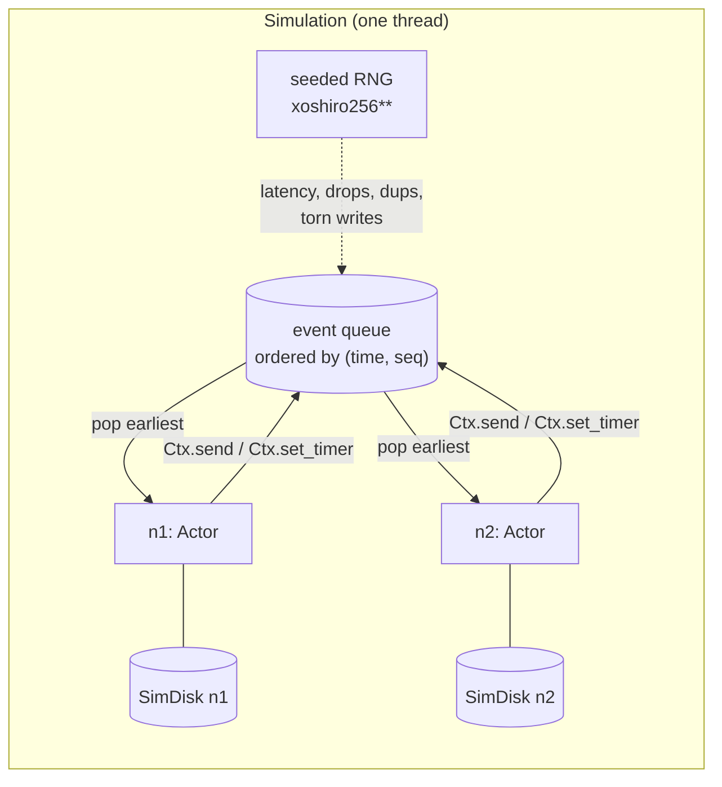
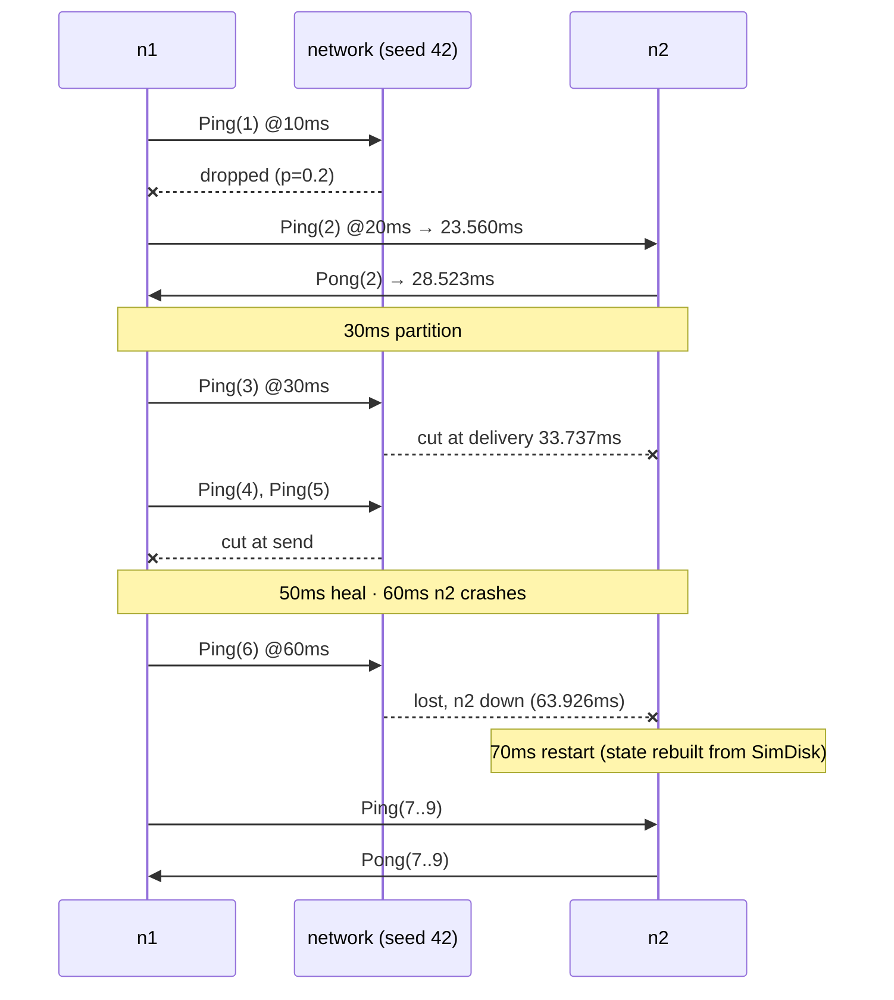

# A. Deterministic simulation

> Data in this chapter is produced by
> `cargo run -p stowage-sim --example trace -- 42` and
> `cargo run -p stowage-sim --example disk_crash`
> (`make trace` runs the first). The decision behind it is
> [ADR 0001](../adr/0001-deterministic-simulation.md).

Raft, range splits and distributed transactions all fail in the same way: only
under one particular interleaving of messages, timers and crashes. This chapter shows
the machine that lets Stowage find such an interleaving and replay it on demand. We
follow one ping through a lossy network that partitions and loses a node, and then
one write through a power loss.

## A.1 The whole world is one priority queue



A node is an `Actor` with three callbacks: `on_start`, `on_message` and `on_timer`.
Inside a callback it can only:

- read virtual time;
- draw from the shared RNG;
- send a message;
- set a timer;
- use the `Disk` and `Clock` it was constructed with.

The simulator turns sends and timers into `Scheduled { at, seq, event }` entries.
`at` is virtual nanoseconds. `seq` is a global counter that breaks ties. Popping the
smallest `(at, seq)` gives one global order of everything that ever happens, and the
seed fully determines that order.

When a message is sent, the RNG decides its fate. With the config below, it is
dropped with probability 0.2, duplicated with probability `dup_prob` (0 here), and
otherwise delivered after a latency drawn uniformly from 0.5–5 ms. Messages sent in
order can therefore arrive out of order.

## A.2 One run, event by event

The scenario has two nodes and 20% message loss. Node 1 sends `Ping(n)` to node 2
every 10 ms, and node 2 answers `Pong(n)`. The test script then does the following:

| Virtual time | Action |
|---|---|
| 30 ms | partition n1 from n2 |
| 50 ms | heal the partition |
| 60 ms | crash n2 |
| 70 ms | restart n2 |

This is the real trace for seed 42:

```text
    0.000ms start n1
    0.000ms start n2
   10.000ms timer n1 #0
   10.000ms drop n1->n2 Ping(1)            ← (a) lost to the 20% loss rate
   20.000ms timer n1 #0
   23.560ms recv n1->n2 Ping(2)            ← 3.560 ms latency
   28.523ms recv n2->n1 Pong(2)
   30.000ms timer n1 #0                    ← Ping(3) leaves n1, due at 33.737
   30.000ms partition [1] | [2]
   33.737ms cut n1->n2 Ping(3)             ← (b) in flight when the link was cut
   40.000ms timer n1 #0
   40.000ms cut n1->n2 Ping(4)             ← (c) refused at send time
   50.000ms timer n1 #0
   50.000ms cut n1->n2 Ping(5)             ← timer ran before heal at the same instant
   50.000ms heal
   60.000ms timer n1 #0
   60.000ms crash n2
   63.926ms lost n1->n2 (down) Ping(6)     ← (d) arrived at a dead process
   70.000ms timer n1 #0
   70.000ms restart n2
   73.571ms recv n1->n2 Ping(7)
   77.676ms recv n2->n1 Pong(7)
   80.000ms timer n1 #0
   83.700ms recv n1->n2 Ping(8)
   86.976ms recv n2->n1 Pong(8)
   90.000ms timer n1 #0
   93.684ms recv n1->n2 Ping(9)
   94.602ms recv n2->n1 Pong(9)            ← reply took 0.918 ms: latency is random
  100.000ms timer n1 #0
  100.000ms drop n1->n2 Ping(10)

stats            SimStats { sent: 14, delivered: 8, dropped: 3, duplicated: 0, partitioned: 3, timers_fired: 10, crashes: 1 }
pongs at node 1  4 (last: Pong(9))
```

The same run as a sequence diagram:



Four ways a message dies, each matching a real failure:

| | Trace line | Real-world equivalent | Counted as |
|---|---|---|---|
| (a) | `drop` | packet loss, overloaded queue | `dropped` |
| (b) | `cut` at delivery | link fails while the packet is in flight | `partitioned` |
| (c) | `cut` at send | link already down | `partitioned` |
| (d) | `lost … (down)` | process dead, port closed | `dropped` |

`sent: 14` is 10 pings plus 4 pongs. Of those, 8 were delivered, 3 were dropped
((a) twice plus (d)) and 3 were cut ((b) and (c) twice). Note what is missing: no
timer of the *old* n2 ever fires after 60 ms. Each timer is tagged with its node's
incarnation number, and a crash bumps that number, so stale timers are discarded
instead of running against the new process.

## A.3 Same seed, same world

Each processed event is formatted (as shown above) and folded into a 64-bit FNV-1a
hash:

```text
fingerprint      seed 42: cfef0ef623f6f754
fingerprint      seed 42: cfef0ef623f6f754 (second run)
fingerprint      seed 43: c0ed8b4aea7fe1fd
```

The test `same_seed_same_history_different_seed_different_history` asserts this for
every seed it runs. When a Raft test fails in CI with `STOWAGE_SIM_SEED=…`, running
that seed locally reproduces the identical history, down to the nanosecond. If any
code path secretly reads the real clock or iterates a randomly-seeded `HashMap`, two
runs of one seed diverge and this test catches it.

How seeds are chosen:

| Variable | Effect |
|---|---|
| *(none)* | each test's fixed seed list |
| `STOWAGE_SIM_SEEDS=200` | fixed seeds + 200 fresh random ones (CI `simulation` job) |
| `STOWAGE_SIM_SEED=42` | exactly seed 42 (reproduce a failure) |

## A.4 One write through a power loss

`SimDisk` keeps two images of every file. Reads see the *volatile* image. Only the
*durable* image survives a crash. The namespace (which names exist) is split the
same way:

```text
             write_at()            sync()               crash()
 caller ───────────────► volatile ─────────► durable ─────────► what restarts see
                         image + pending      image
                         ops list

             create / rename / remove      sync_dir()          crash()
 caller ───────────────► live namespace ─────────► durable namespace ─────► restarts
```

**Contents.** `put a=1;` is synced and `put b=2;` is not. The handle opened before
the crash is dead afterwards, just like a file descriptor of a killed process:

```text
before crash: "put a=1;put b=2;"
old handle:   Err("stale file handle: the node crashed")
after crash:  "put a=1;"
```

**Namespace.** The classic "write temp file, fsync it, rename over the old one"
pattern is *not* durable until the directory itself is fsynced:

```text
before crash: ["MANIFEST"]
after crash (no sync_dir): []
```

The storage engine (M1) and the Raft log (M2) both install new metadata this way.
The sim makes it impossible to forget the `sync_dir()`.

**Torn writes.** Real disks guarantee atomicity per sector at best. In
`CrashMode::Torn`, each unsynced write independently survives whole (p = ½), is torn
after a random number of whole 512-byte sectors (p = ¼), or is lost (p = ¼). Here
is one unsynced 2048-byte write, crashed under 1000 different seeds:

```text
survived whole: 516
lost entirely:  234
torn after 1 sector(s) (512 bytes): 79
torn after 2 sector(s) (1024 bytes): 100
torn after 3 sector(s) (1536 bytes): 71
```

A torn prefix is the reason the WAL in M1 has a CRC32C per record and stops replay
at the first record that fails its checksum. Chapter 02 will crash a real WAL in this
mode and show recovery discarding exactly the torn tail.

## A.5 Where this goes next

| Milestone | Runs inside the simulator |
|---|---|
| M1 | B+Tree + WAL under `CrashMode::Torn`, recovery checked after every crash |
| M2 | Raft groups under loss, partitions and crashes; a linearizability checker over the client history |
| M3 | range splits and rebalancing with nodes failing mid-move |
| M4 | bank-transfer transactions; Elle-style cycle detection for SI / SSI anomalies |
